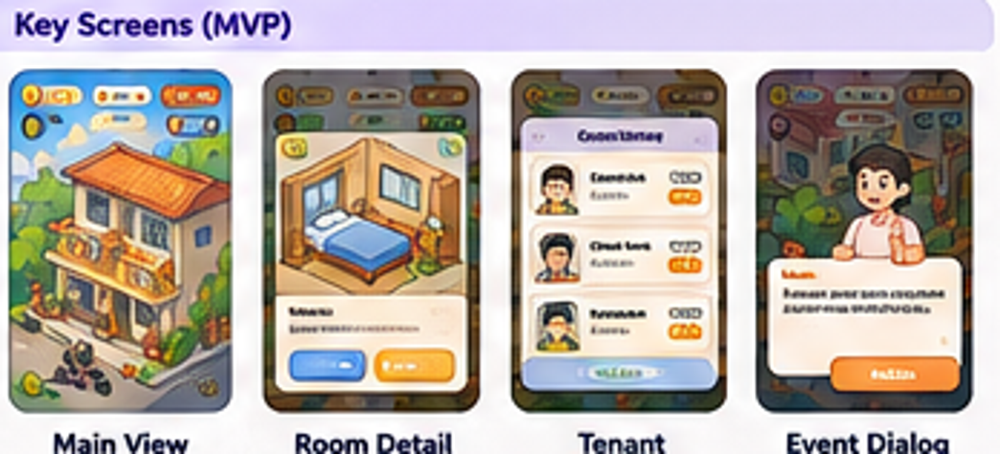
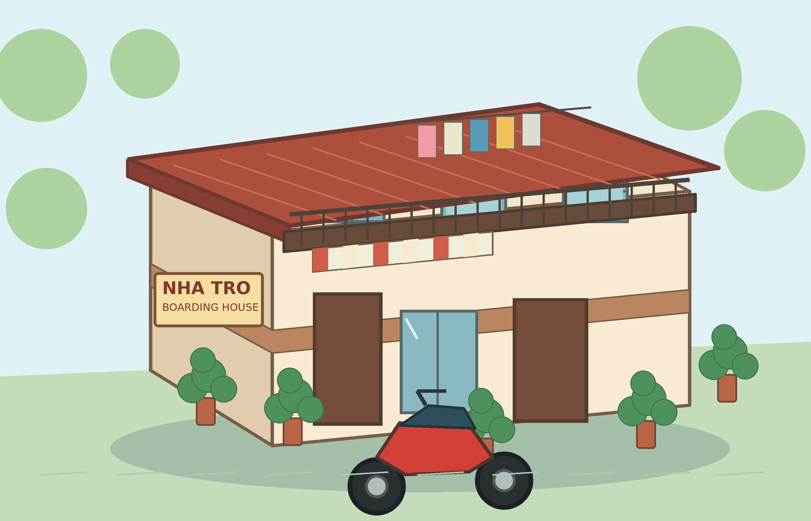

# Boarding House Tycoon — Visual Direction & Asset Production Guide

- **Document ID:** BHT-ART-001
- **Version:** 1.0
- **Status:** Approved visual direction for MVP exploration; production asset details remain subject to art test
- **Related documents:**
  - [`../gdd/game-design-plan.md`](../gdd/game-design-plan.md)
  - [`../planning/technical-architecture.md`](../planning/technical-architecture.md)
  - [`../decisions/0001-react-phaser-capacitor.md`](../decisions/0001-react-phaser-capacitor.md)
  - [`../decisions/0003-web-first-responsive-delivery.md`](../decisions/0003-web-first-responsive-delivery.md)

## 1. Purpose and authority

This document defines the visual target and practical asset rules for the MVP. It is intended for artists, UI designers, and developers integrating assets into Phaser.

The GDD remains authoritative for gameplay. This document is authoritative for visual consistency and asset-production expectations. Reference images are inspiration and must not override written gameplay rules or be treated as finished production assets.

## 2. Locked visual direction

| Area | Decision |
|---|---|
| Overall style | Friendly 2D isometric / 2.5D cartoon |
| Camera | Consistent isometric three-quarter view; authored 2D sprites rather than a true 3D simulation |
| Setting | Modern Vietnamese boarding house and its shared spaces |
| Mood | Warm, welcoming, lightly humorous, readable at phone and desktop sizes |
| Platform composition | Responsive web; portrait phone (9:16) is the primary composition, with landscape and desktop widths scaling the same scene |
| Rendering | Phaser 2D scene with layered sprites and visual state changes |
| Visual progression | Room and property upgrades must be visible on the main property view |

The game should feel like a charming, stylized place the player is improving over time. It should not look like a realistic rental-business dashboard, a gritty housing documentary, or a high-detail architectural simulator.

## 3. Art principles

### 3.1 Readability before detail

- The silhouette of each building, room, tenant, and interactive object must remain clear at normal phone viewing size.
- Important gameplay objects must not disappear into decorative texture or background clutter.
- Use simple shapes and controlled detail density. Add small props only when they help establish the Vietnamese boarding-house setting or communicate gameplay.
- Keep interactive room hit areas larger and more forgiving than the visible details of individual furniture items.

### 3.2 Consistent perspective

- Use one consistent isometric projection and camera angle across environment, rooms, furniture, characters, and props.
- Match horizon, visible wall faces, floor planes, and object orientation to the same scene perspective.
- Do not mix top-down assets, side-view assets, and isometric assets in the same playable scene unless they are intentionally part of the flat UI layer.
- Place depth sorting anchors at the ground contact point (or another documented common anchor), not arbitrarily at the top-left of each image.

### 3.3 Consistent lighting and line treatment

- Use one coherent light direction across a scene and its reusable assets.
- Keep shadows soft and readable; avoid realistic high-contrast lighting that conflicts with the cartoon direction.
- Keep outline weight and edge treatment consistent between environment, rooms, characters, and props.
- Avoid mixing painterly, photorealistic, pixel-art, and vector-flat asset styles in the same production set.

### 3.4 Friendly tone and humor

- Humor should come from recognizable situations, expressive reactions, and small environmental details.
- Characters should be expressive without becoming hostile or grotesque.
- Do not use poverty, occupation, age, or appearance as a shorthand for a negative personality. A tenant can be messy or demanding as a gameplay role without being demeaning or stereotyped.

## 4. Vietnamese boarding-house identity

Use a small number of recognizable local details to make the setting specific without overcrowding the screen:

- Motorbike parking and helmets.
- Laundry lines and drying clothes.
- Potted plants near entrances and corridors.
- Utility meters, electrical boxes, and water taps.
- Shared corridors, stairs, balconies, gates, and simple room doors.
- Handwritten/simple building signs and house rules.
- Familiar everyday objects inside rooms: fan, bed, wardrobe, small table, refrigerator, and air conditioner at higher room levels.

Choose details that are readable at the target camera scale. Do not add every listed prop to every scene.

## 5. Environment and property composition

### 5.1 Main property view

The main property view is the primary play space. It must:

- Communicate the number of rooms and which rooms are vacant or occupied.
- Provide a clear visual state for each room level.
- Keep the entrance, circulation, and shared areas understandable.
- Reserve visual space for HUD and mission/event UI without covering the rooms that the player needs to select.
- Support the MVP's progression from 2 to 4 to 6 rooms without changing the art style or camera convention.

The six-room layout should be composed for portrait screens. The implementation may use authored fixed room positions for MVP; a general-purpose building editor is not required.

### 5.2 Room presentation

Rooms use a readable open-front / cutaway presentation so their interior upgrades can be seen. The camera angle and floor/wall relationship must remain consistent across all three levels.

Room level changes must be visible on the main property view, not only in a room-detail popup.

## 6. Room upgrade visual language

The gameplay levels are defined in the GDD. The visual language should support these differences:

| Level | Visual intent | Example visual cues |
|---|---|---|
| Level 1 — Basic | Simple, functional, low-cost room | Basic bed, simple storage, fan or essential furniture, limited decoration |
| Level 2 — Improved | Cleaner and more comfortable | Better bed, wardrobe, desk/table, improved lighting, a plant or wall decoration |
| Level 3 — Premium | Clearly higher comfort and perceived value | Air conditioner, better furniture, coordinated decoration, warmer lighting and richer materials |

Do not communicate a level increase only by changing color or adding a badge. At least one meaningful piece of furniture, fixture, or room finish must change.


*Concept reference only. Production assets must be redrawn or created to the project's final style and scale.*

## 7. Character direction

### 7.1 Archetypes

The MVP includes Student, Office Worker, and Messy Tenant. Characters should be distinguishable through a combination of silhouette, clothing, posture, expression, and one or two props.

- **Student:** casual clothing and a backpack or study-related prop; approachable and budget-conscious.
- **Office Worker:** neat smart-casual/work clothing and a work bag; calm, stable presentation.
- **Messy Tenant:** casual clothing and a slightly disorganized prop or pose; humorous but not dirty, threatening, or dehumanized.

These are visual communication cues, not rigid assumptions about real people. Avoid using skin tone, body shape, disability, or other sensitive traits to signal a gameplay archetype.

### 7.2 Expression set

For the MVP, prioritize a compact reusable expression set:

- Neutral / idle.
- Happy / accepted.
- Worried / asking for help.
- Annoyed / complaint.
- Surprised / event reaction.

Expression changes can be implemented as sprite swaps or lightweight animation. Full skeletal animation is not required for the MVP.


*Concept reference only; use it to communicate differentiation and tone, not as a final character model sheet.*

## 8. Event illustration and feedback

- Event art should make the situation recognizable before the player reads the full text.
- Prefer one character reaction plus one clear environmental cue (for example, a tenant near a blocked corridor or a broken shared tap).
- Keep event dialogs readable and compact on portrait devices.
- Show the cost and the consequence of each choice in text; the illustration is not a substitute for a rules explanation.
- Reuse character poses and props where possible to keep MVP content production small.

## 9. UI visual direction

React renders the standard application UI above the Phaser canvas. UI and game-world art must feel like one product, but should remain visually distinct enough that information is easy to read.

- Use a friendly, clean, casual interface with clear hierarchy.
- Use rounded panels and buttons sparingly and consistently.
- Keep Cash, current income rate, main mission, and event notification easy to scan.
- Use clear states for enabled, disabled, selected, locked, affordable, and unaffordable actions.
- Do not rely on color alone to communicate state; pair color with icon, text, or shape.
- Ensure text contrast and comfortable reading sizes at phone and desktop widths.
- Use touch targets that are comfortable for repeated tapping and clear mouse targets on desktop; confirm final sizes in the UI interaction spec and real-device tests.
- Respect device safe areas and avoid placing critical actions under system UI.

The UI reference image is a composition and hierarchy reference only. Any generated gibberish or placeholder labels in the image are not product copy. Use the GDD's written screen names and real UI strings.



*AI-generated concept reference only. Do not trace the placeholder text or treat the pictured layout as final pixel-perfect UI.*

## 10. Environment concept reference



*Concept reference for the Vietnamese boarding-house setting, warm palette, motorbike parking, signage, plants, and laundry details. It is not a final production sprite or a locked layout.*

## 11. Asset production rules

### 11.1 File and source format

- Keep editable source files in the art source repository or the team's chosen design tool; export runtime assets into the game repository.
- Use transparent PNG for assets that need alpha transparency and WebP where the pipeline and target devices support it without visual defects.
- Prefer sprite atlases for related assets when this simplifies loading and reduces draw-call overhead.
- Avoid embedding text in reusable art unless the text is a fixed environmental sign approved by design. UI text must be rendered by React and localized independently.
- Do not ship reference images or contact sheets as runtime assets unless explicitly approved.

### 11.2 Naming convention

Use lowercase kebab-case names with stable semantic IDs:

```text
building-main-level-01.png
room-level-01-base.png
room-level-02-improved.png
room-level-03-premium.png
tenant-student-idle.png
tenant-office-worker-idle.png
tenant-messy-idle.png
event-water-tap-broken.png
prop-motorbike-red.png
ui-icon-cash.png
```

Avoid names based on temporary export dates, artist initials, or vague labels such as `final2-new.png`.

### 11.3 Anchors, scale, and atlases

- Agree a reference canvas scale and Phaser world scale before producing a full batch of assets.
- Every sprite family must document its anchor/origin convention. World objects should generally use a ground-contact anchor for depth sorting.
- Keep character feet and room/furniture contact points aligned consistently across animation frames.
- Do not mix different pixel densities or arbitrary scales within one asset family.
- Atlas metadata and frame names must be stable and referenced through typed asset keys rather than scattered raw paths.
- Export room levels with matching framing so upgrades can transition without visual jumps.

### 11.4 Animation budget

MVP animation should be lightweight and purposeful:

- Short room upgrade transition.
- Subtle ambient character idle or reaction.
- Small event notification/attention cue.
- Simple feedback when Cash is earned or spent.

Do not require full skeletal animation, pathfinding, complex crowd simulation, or physics-based object motion for the MVP.

## 12. MVP asset checklist

### Environment

- [ ] Main boarding-house exterior / shell.
- [ ] Fixed room layout for 2, 4, and 6 room progression states.
- [ ] Shared corridor / access areas.
- [ ] Entrance, gate, stairs/balcony elements as required by the chosen composition.
- [ ] Small set of Vietnamese identity props: motorbike(s), laundry, plants, utility meter, water tap, signage.

### Rooms

- [ ] Level 1 room visual.
- [ ] Level 2 room visual.
- [ ] Level 3 room visual.
- [ ] Consistent framing and anchor/origin across all levels.
- [ ] Clear vacant and occupied visual state (without excessive clutter).

### Characters

- [ ] Student idle + compact expression variants.
- [ ] Office Worker idle + compact expression variants.
- [ ] Messy Tenant idle + compact expression variants.
- [ ] Consistent proportions, outline, lighting, and anchor.

### Events

- [ ] Shared utility outage illustration/prop.
- [ ] Hallway clutter illustration/prop.
- [ ] Broken shared water tap illustration/prop.
- [ ] Noise complaint reaction.
- [ ] Group-of-students opportunity illustration or reusable character grouping.

### UI

- [ ] Main property HUD assets/icons.
- [ ] Cash icon.
- [ ] Mission and event status icons.
- [ ] Buttons and panel states.
- [ ] Room level/upgrade icons.

### Integration checks

- [ ] All assets load through the Phaser asset loader.
- [ ] Room level transitions preserve framing and selection hit areas.
- [ ] Depth ordering works for each room and character.
- [ ] Assets remain readable at portrait phone and desktop viewport sizes.
- [ ] Compressed assets are visually checked in a real mobile browser (Android Chrome and iOS Safari).

## 13. Review and acceptance

An asset is ready for integration only when:

1. It matches the approved perspective, style, lighting, and outline treatment.
2. It has the correct transparent bounds, anchor/origin, and scale metadata.
3. It is readable at the target phone and desktop viewports, not only when zoomed in on a desktop.
4. It maps to a documented gameplay state or approved decorative role.
5. It has a stable asset key/name and is included in the asset manifest.
6. It has been reviewed in the actual Phaser scene alongside neighboring assets.

## 14. Reference asset register

| File | Purpose | Authority |
|---|---|---|
| `assets/boarding_house_environment_concept.png` | Overall Vietnamese boarding-house mood and exterior props | Inspiration only |
| `assets/room_upgrade_reference.png` | Visual distinction between room levels | Inspiration only |
| `assets/tenant_archetype_reference.png` | Character differentiation and friendly tone | Inspiration only |
| `assets/ui_layout_reference.png` | Main screens and information hierarchy | Inspiration only; placeholder text is not authoritative |

All four images are concept references. They are not production-ready sprites, final UI comps, or licensed third-party assets. Replace them with approved production assets as art production proceeds.
