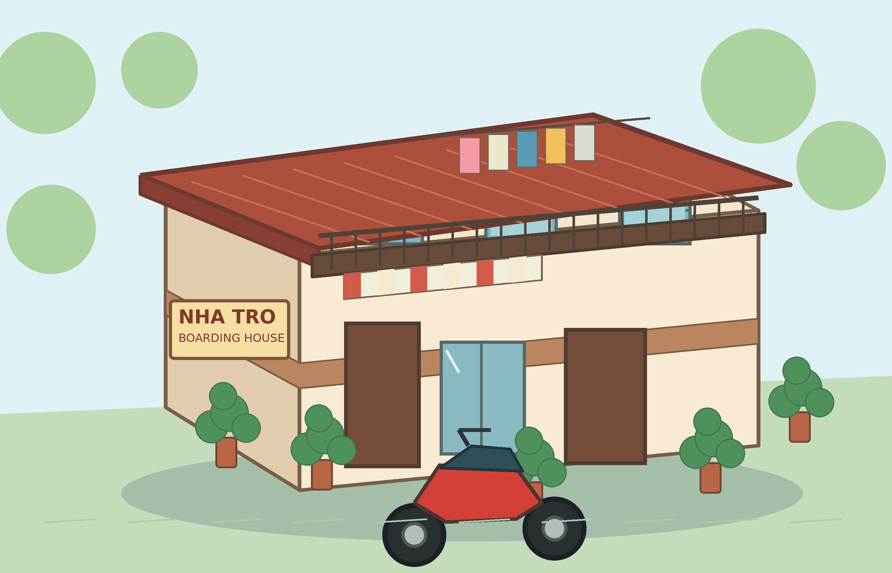
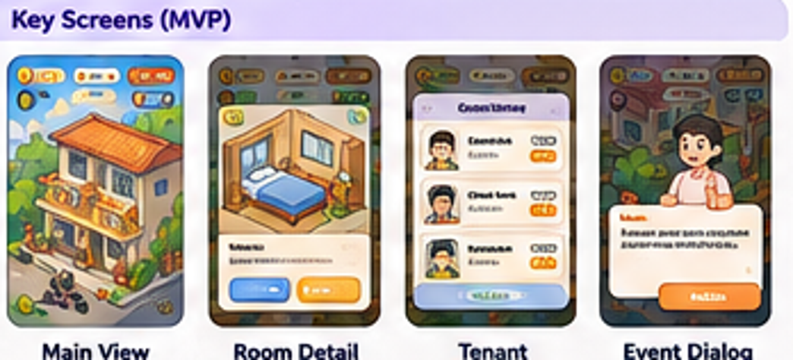

# Boarding House Tycoon — Game Design Document (MVP)

**Version:** 2.0  
**Date:** 7 November 2026  
**Status:** Design baseline for prototype and MVP  
**Working title:** Boarding House Tycoon (English title for the project formerly described as “Tập làm chủ trọ”)

> This GDD turns the original concept into a consistent implementation baseline. Core decisions are locked for the first prototype. Numerical balance values are initial parameters and may be adjusted after playtesting.



## Document guide

1. [Product Overview & Design Pillars](#1-product-overview--design-pillars)
2. [Core Gameplay Loop & Session Design](#2-core-gameplay-loop--session-design)
3. [Economy & Balance Baseline](#3-economy--balance-baseline)
4. [Building & Room Upgrade System](#4-building--room-upgrade-system)
5. [Tenant System](#5-tenant-system)
6. [Event System](#6-event-system)
7. [Mission & Progression System](#7-mission--progression-system)
8. [Time, Offline Income & Save Data](#8-time-offline-income--save-data)
9. [UI/UX Requirements](#9-uiux-requirements)
10. [Art Direction & Content Guidelines](#10-art-direction--content-guidelines)
11. [MVP Scope & Non-Goals](#11-mvp-scope--non-goals)
12. [Acceptance Criteria & Playtest Plan](#12-acceptance-criteria--playtest-plan)
13. [Developer Configuration Reference](#13-developer-configuration-reference)
14. [Release Baseline (P2)](#14-release-baseline-p2)

[Appendix: Key Definitions & Design Assumptions](#appendix-key-definitions--design-assumptions) (unnumbered)

## 1. Product Overview & Design Pillars

### 1.1 Product snapshot

| Field | Decision |
|---|---|
| Genre | Casual Idle Tycoon / Lightweight Management |
| Platform | Web browser first, responsive; one build runs in desktop browsers, Android Chrome, and iOS Safari. No store wrapper in MVP (ADR 0003) |
| Orientation | Portrait, 9:16 |
| Camera | 2D isometric or 2.5D cartoon |
| Mode | Single-player with offline progression |
| Target session | Approximately 2–5 minutes |
| MVP property size | One property, expandable to six rentable rooms |

### 1.2 Product promise

Start with a modest boarding house, earn rent from occupied rooms, accept suitable tenants, handle occasional situations, and reinvest income into new rooms and upgrades. Growth must be visible in both the economy and the environment.

### 1.3 Design pillars

- **Visible Growth:** The property visibly improves over time.
- **Meaningful Investment:** The player chooses between expanding capacity and improving income per room.
- **Lightweight Management:** Tenants and events create variety without becoming chores.
- **Idle Progression:** The property continues earning while the player is away.

### 1.4 Explicit non-pillars

The MVP is not a realistic rental-business simulator. It does not simulate tenant needs, schedules, relationships, staff, accounting, taxes, or complex leases. It must not punish players for being offline.

## 2. Core Gameplay Loop & Session Design

| Step | Player activity | Game response |
|---|---|---|
| 1. Earn | Review accumulated rent. | Occupied rooms generate passive income automatically. |
| 2. Manage | Review vacant rooms, candidates, and events. | Accept tenants and resolve optional situations. |
| 3. Invest | Choose a room to build or upgrade. | Cash is spent and the property changes visually. |
| 4. Grow | Increase occupancy and room quality. | Net income rises and milestones approach. |
| 5. Unlock | Reach occupancy and upgrade requirements. | Room capacity and higher room levels unlock. |

Missions and events support the loop; they are not mandatory steps in every session. A normal 2–5 minute session should allow the player to review income, accept or reject a candidate, resolve an event if one is waiting, and make an investment.

## 3. Economy & Balance Baseline

### 3.1 Currency and time

- Cash is the only MVP currency.
- **1 Game Day = 1 real-time hour.**
- Rent accrues continuously and proportionally to elapsed game time.
- A room earns `Rent per Game Day / 60` each real minute while occupied.
- Operating cost is 10% of gross rent. Net income is 90% of gross rent.
- Vacant rooms produce no rent and incur no room-specific operating cost.
- Display whole Cash values, but preserve fractional accrual internally.

### 3.2 Rent and net income

| Room level | Gross rent / Game Day | Operating cost | Net income / Game Day |
|---|---:|---:|---:|
| Level 1 | 120 | 12 | 108 |
| Level 2 | 210 | 21 | 189 |
| Level 3 | 350 | 35 | 315 |

Because one Game Day equals one real hour, net income per Game Day is also the net income rate per real-time hour for a continuously occupied room.

```text
GrossIncomePerGameDay = Sum(RoomRent for all occupied rooms)
OperatingCost = GrossIncomePerGameDay * 10%
NetIncomePerGameDay = GrossIncomePerGameDay * 90%
CashAccrued = NetIncomePerGameDay * ElapsedRealHours
```

### 3.3 Construction and upgrades

| Action | Cost (Cash) |
|---|---:|
| Build Room 3 | 900 |
| Build Room 4 | 1,400 |
| Build Room 5 | 2,100 |
| Build Room 6 | 3,000 |
| Upgrade Level 1 → Level 2 | 650 |
| Upgrade Level 2 → Level 3 | 1,300 |

Capacity expansion itself is free; the player pays to construct each room. New rooms start at Level 1.

### 3.4 Starting state

| Item | Value |
|---|---|
| Starting Cash | 1,000 |
| Initial room slots | 2 |
| Initial rooms | 2 × Level 1 |
| Initial occupancy | 1 occupied / 1 vacant |
| Initial tenant | 1 Office Worker in a Level 1 room |
| Initial candidate | 1 Student candidate |

This starting tenant/candidate combination is intentional: the Office Worker can afford a Level 2 room later, and the Student can afford the vacant Level 1 room.

### 3.5 Investment payback

| Investment | Cost | Increase in net income | Approx. payback |
|---|---:|---:|---:|
| Build Room 3 (Level 1) | 900 | 108 / Game Day | 8.3 Game Days |
| Build Room 4 (Level 1) | 1,400 | 108 / Game Day | 13.0 Game Days |
| Build Room 5 (Level 1) | 2,100 | 108 / Game Day | 19.4 Game Days |
| Build Room 6 (Level 1) | 3,000 | 108 / Game Day | 27.8 Game Days |
| Upgrade Level 1 → Level 2 | 650 | 81 / Game Day | 8.0 Game Days |
| Upgrade Level 2 → Level 3 | 1,300 | 126 / Game Day | 10.3 Game Days |

Payback assumes continuous occupancy and ignores events or temporary income modifiers. Later room slots intentionally cost more to protect progression pacing.

### 3.6 Economy guardrails

- Never charge operating cost for a vacant room.
- Do not let passive operating cost push Cash below zero; the 10% deduction is applied to rent earned.
- Show cost, new rent, net income, and estimated payback before confirmation.
- Do not silently change rent after an upgrade or tenant assignment.

## 4. Building & Room Upgrade System

### 4.1 Capacity progression

| Stage | Unlock condition | Capacity | Unlocks |
|---|---|---:|---|
| Start | Default | 2 | Core room and tenant loop |
| Expansion 1 | 2 occupied rooms | 4 | Level 2 upgrades and two build slots |
| Expansion 2 | 4 occupied rooms AND at least 2 Level 2 rooms | 6 | Level 3 upgrades and two build slots |

### 4.2 Room levels

| Level | Description | Rent / Game Day | Eligible tenants |
|---|---|---:|---|
| Level 1 — Basic | Simple furniture and essential facilities | 120 | Student, Office Worker, Messy Tenant |
| Level 2 — Improved | Cleaner, better furnished, more comfortable | 210 | Office Worker |
| Level 3 — Premium | Air conditioning, premium furniture/decor | 350 | Office Worker |


### 4.3 Upgrade rules

- A room can be upgraded only when the next level is unlocked.
- An occupied room can be upgraded only if its current tenant budget is at least the new room rent.
- Vacant rooms can be upgraded after the level unlocks.
- Upgrades apply instantly after Cash is deducted.
- Every level must visibly change the main property view.

## 5. Tenant System

### 5.1 MVP archetypes

| Archetype | Maximum budget / Game Day | Preferred room | Gameplay role |
|---|---:|---|---|
| Student | 150 | Level 1 | Budget-sensitive basic tenant |
| Office Worker | 380 | Level 2–3 | Stable higher-budget tenant; can afford all levels |
| Messy Tenant | 180 | Level 1 | Can make hallway/cleanliness events more likely |


### 5.2 Matching rules

- A candidate is eligible for a room when `Maximum Budget >= Room Rent`, where Room Rent is the current rent of that room at its current level (vacant rooms included).
- Preferred room level is a preference, not an absolute restriction. An Office Worker may rent Level 1 if needed.
- Students and Messy Tenants can rent Level 1 only under current rent values.
- The player chooses the compatible vacant room; no automatic assignment.

### 5.3 Candidate generation

| Rule | Baseline |
|---|---|
| Generation interval | One candidate check every 5 minutes of active online play |
| Eligibility | At least one vacant room can be afforded by an archetype |
| Queue limit | 3 candidates |
| Weights | Student 50%, Office Worker 30%, Messy Tenant 20% among eligible archetypes; re-normalize if some are ineligible |
| Persistence | Candidate remains while offline; no expiration in MVP |
| Player action | Accept and assign, or reject |

Resolved generation rules:
- Each check (every 5 active online minutes) adds at most one candidate. There is no probability roll.
- A check does nothing if the queue already holds 3 candidates, or if no archetype has at least one vacant room whose rent it can afford.
- When a check adds a candidate, the archetype is chosen by the weights above, re-normalized over archetypes that currently have an affordable vacant room.

### 5.4 Room and tenant lifecycle

The candidate queue is separate from room state. A room is either Vacant or Occupied; accepting a candidate assigns the tenant and changes the room to Occupied. Tenants do not leave automatically on a timer. There is no routine churn; once accepted, a tenant remains assigned until the player moves them out. The player can move out an occupied tenant from Room Detail after a confirmation dialog. Moving out is free, makes the room Vacant immediately, stops that room's income, and discards the tenant (the tenant does not return to the queue). Moving out does not affect cooldowns. No satisfaction, lease expiry, payment reliability, or relationship meters are included.

## 6. Event System

### 6.1 Categories

Financial, Daily Life, Facility, and Opportunity. The MVP uses five representative event templates.

### 6.2 Global event rules

| Rule | Baseline |
|---|---|
| Trigger mode | Online only |
| Check interval | Every 5 minutes of active online time |
| Base chance | 25% per valid check when at least one event is eligible |
| Active limit | 1 unresolved event |
| Global cooldown | 10 minutes of active online time after resolution |
| Frequency cap | 3 events per rolling 60-minute online window |
| Per-event cooldown | 30 minutes of active online time |
| Pending event | Persists if the app closes |
| Outcome | Deterministic; randomness selects an event, not its result |

### 6.3 Selection algorithm

1. Every five active minutes, verify no event is active, the global cooldown has elapsed, and the rolling-hour cap has room.
2. Roll the 25% base chance.
3. Build the eligible event pool using current rooms, tenants, Cash, and cooldowns.
4. Select one eligible event. If none are eligible, show nothing. Selection is uniform across eligible events, except that Hallway clutter has double weight while at least one Messy Tenant is occupying a room.
5. Present exact costs and effects. Keep the event pending until chosen.
6. Apply the deterministic outcome and save state.

### 6.4 MVP event catalogue

| Event | Condition | Choice A | Choice B |
|---|---|---|---|
| Shared utility outage (Financial) | At least 2 occupied rooms | Pay 120 Cash now to restore full service; no income modifier | Wait 1 Game Day: all occupied rooms earn 10% less gross rent during the outage |
| Hallway clutter (Daily Life) | At least 1 occupied room; double selection weight while a Messy Tenant is occupying a room | Warn for free; no effect; event closes with no penalty and no extra cooldown | Hire cleaner for 100 Cash; clear issue and suppress this event for 60 online minutes |
| Broken shared water tap (Facility) | At least 1 occupied room | Repair for 150 Cash; no rent penalty | Delay for 1 Game Day; gross rent from all occupied rooms is reduced by 15% during that period, then the issue clears and normal rent resumes |
| Noise complaint (Daily Life) | At least 1 occupied room | Warn for free; that tenant cannot be the target of a noise event for 30 online minutes | Hire mediator for 80 Cash; suppress noise events for that tenant for 60 online minutes |
| Group of students wants two rooms (Opportunity) | Two vacant Level 1 rooms | Accept; two Student tenants are created directly and assigned to those two rooms, bypassing the candidate queue | Decline; no cost or penalty |

Target and reduction rules:
- **Noise target:** the event picks one occupied room's tenant uniformly at random. The same tenant cannot be targeted again for 30 online minutes. Hire mediator suppresses noise events for that tenant for 60 online minutes; the mediator choice applies to the tenant shown in the event.
- **Delay reduction:** the 15% reduction applies to gross rent. The 10% operating cost is then applied to the reduced gross as usual, so net income falls by 15% of gross × 90%.
- **Group of students:** the two Student tenants do not count against the queue limit and do not appear as candidates.

Choices are deterministic. Unaffordable Cash options are disabled. No event is spawned while offline.

## 7. Mission & Progression System

### 7.1 Main Mission chain

| # | Objective | Reward |
|---:|---|---:|
| 1 | Accept the second tenant | 100 |
| 2 | Upgrade one room to Level 2 | 150 |
| 3 | Build the third room | 200 |
| 4 | Have 3 occupied rooms | 150 |
| 5 | Have 4 occupied rooms | 250 |
| 6 | Have 2 rooms at Level 2 | 300 |
| 7 | Upgrade one room to Level 3 | 400 |

### 7.2 Milestones

- **Start:** 2 room slots and basic tenants.
- **Milestone 1:** 2 occupied rooms → capacity 4 and Level 2 unlock.
- **Milestone 2:** 4 occupied rooms and at least 2 Level 2 rooms → capacity 6 and Level 3 unlock.
- **MVP completion:** The player has built all 6 rooms and completed the Main Mission chain (all 7 missions). Mission 7 requires only one room at Level 3, not all six.
- **After completion:** Show a congratulation screen with a summary of the run. The player then keeps playing freely: the economy, events, and offline income continue, and no new mission is offered in the MVP.

Only one Main Mission is active. Progress is automatic; rewards are credited to Cash and saved once. Daily Missions and Event Missions are deferred.

## 8. Time, Offline Income & Save Data

### 8.1 Offline rules

- Offline cap: 8 hours per interval.
- Only occupied rooms earn income.
- Use the same net rent rate as online play.
- No new events or candidates are generated offline.
- Existing tenants and candidates persist.
- Event/candidate cooldowns advance only during active online time. Temporary income modifiers are a separate rule: they keep counting down offline (see 8.2).
- The same offline interval must never be credited twice.
- Active online time means time while the app is in the foreground and visible. Background time does not advance online-only timers (checks, cooldowns, the rolling-hour cap). No network connection is required.
- Each resume credits only its own interval, from the last checkpoint to the resume time. Time beyond 8 hours is lost and is not carried over to the next resume.

### 8.2 Formula

```text
offlineElapsed = min(max(now - lastCheckpointAt, 0), 8 hours)
netRentPerGameDay = sum(occupied room rent per Game Day) * 90%
offlineIncome = integral over [lastCheckpointAt, lastCheckpointAt + offlineElapsed]
                of netRentAt(t) / 3,600 dt
```

`netRentAt(t)` = `netRentPerGameDay` × (1 − `reduction(t)`), where `reduction(t)` is the sum of active building-wide income reductions at time `t`, capped at 25%. Each temporary modifier has an absolute expiry timestamp. To compute the offline income, split the offline interval at every modifier expiry inside it, then sum the constant-rate segments. Modifiers keep elapsing offline; they are not paused. The result is converted to integer minor units, and the fractional remainder is kept.

The same formula is used in [tech doc 9.2](../planning/technical-architecture.md). If one changes, change the other.

Example without active temporary modifiers: L1 + L2 + L3 = 120 + 210 + 350 = 680 gross per Game Day. Net income is 612 per hour. Eight offline hours award **4,896 Cash**. If a temporary income modifier is active, integrate the reduced rent only over the part of the offline interval where it remains active; temporary modifiers continue to elapse offline. Multiple building-wide reductions add together and are capped at 25%. Each temporary modifier is stored with an absolute expiry timestamp. The offline calculation splits the eligible interval at each modifier's expiry and integrates the net rent piece by piece.

### 8.3 Save data

Persist player Cash, building capacity, rooms and levels, tenant assignments, candidate queue, active event and cooldowns, mission progress and rewards, unlocked milestones, last credited checkpoint timestamp (`lastCheckpointAt`), fractional income remainder, and save schema version.

Autosave after every meaningful state change and at least every 60 seconds. On resume, calculate offline income once, apply it, update the checkpoint, and persist atomically. If the device clock moves backward, treat offline duration as zero. Temporary income modifiers continue to elapse offline, and the offline calculation must integrate their remaining duration. Local save is enough for MVP; cloud sync is deferred.

## 9. UI/UX Requirements

The Main Property View is the primary play space. MVP screens are:

1. **Main Property View:** isometric house, Cash, net income rate, Main Mission, event indicator, and navigation.
2. **Room Detail:** room level, tenant, rent, net income, upgrade cost, and affordability state.
3. **Tenant Management:** candidate cards, budgets, compatible rooms, accept/reject.
4. **Event Dialog:** scenario, category, affected entity, exact costs, and deterministic outcomes.



The screen image is AI-generated visual inspiration only; its text is not authoritative. Functional labels must follow the written rules. Important actions should be reachable in one or two navigation steps, with readable tap targets on touch screens and clear click targets on desktop, at portrait phone, landscape phone, and desktop widths.

### 9.1 Language and text

- **Primary language:** Vietnamese. All player-facing text is stored in one text file of keys and values, so another language can be added later without code changes.
- **Content ownership:** The product owner writes and approves all text for the MVP. No external review is required.
- **Names:** Tenant display names are Vietnamese.

### 9.2 Onboarding

A four-step overlay guide runs once on a new save:
1. Collect the first rent payment.
2. Accept the first candidate.
3. Open Room Detail.
4. Upgrade or build a room when the player can afford it.

Each step shows one short text block and advances when its action is completed. The guide can be skipped. Its completion is saved.

### 9.3 Audio

- Roughly 8 sound effects: rent collected, build, upgrade, accept, reject, event appears, mission completed, and error.
- No background music in the vertical slice.
- A mute toggle is available in Settings.

### 9.4 Settings

- Sound on/off.
- Language selector, shown only when more than one language exists.
- Reset save, behind a confirmation dialog that warns the player that progress on this device will be lost.
- No push notifications.

## 10. Art Direction & Content Guidelines

- **Style:** friendly 2D isometric / 2.5D cartoon.
- **Setting:** modern Vietnamese boarding house.
- **Environment details:** motorbike parking, laundry lines, potted plants, utility meters, narrow corridors, shared water taps, simple building signage.
- **Characters:** expressive, readable silhouettes; avoid negative stereotypes.
- **Room upgrades:** distinct visual changes at each level.
- **Production:** maintain consistent perspective, lighting, outline, and palette.

The included concept images are illustrative references only, not final game assets.

- **Tenant expressions:** each tenant archetype has 3 expression variants: idle, happy, and annoyed. The annoyed variant appears when the tenant is the target of an event.
- **Room layouts:** one fixed layout is produced for each progression state: 2, 4, and 6 rooms. The art lead designs them. The product owner approves each layout before asset production starts.
- **Placeholder art policy (decided, MVP):** until production art is approved, use placeholder shapes and colors with stable asset keys. Placeholder assets must be labeled as placeholders in the asset manifest. They do not pass the acceptance checks in Visual Direction section 13. Production art replaces a placeholder by its asset key.

## 11. MVP Scope & Non-Goals

### In scope

- One property, up to six rooms, three room levels.
- Cash economy, rent, operating cost, build/upgrade costs.
- Eight-hour offline income.
- Three tenant archetypes, candidate queue, accept/reject.
- Five event templates across four categories.
- One Main Mission chain and two capacity/level milestones.
- Local save/load and four core screens.
- Consistent isometric art direction and visible room upgrades.

### Out of scope

Multiple buildings, VIP/collectible tenants, satisfaction and relationship systems, Daily Missions, staff and automation, multiple currencies, complex lease/tax/debt/accounting simulation, multiplayer/social features, ads, and in-app purchases.

### First playable target

Build and validate the transition from 2 rooms to 4 rooms: rent accrual, tenant acceptance, one upgrade, one new room, one event, one milestone, save/load, and offline income.

## 12. Acceptance Criteria & Playtest Plan

The MVP is complete when:

1. The player understands the main goal and next mission.
2. A compatible tenant can be accepted; an unaffordable assignment is blocked.
3. Rent and 10% operating cost calculate correctly.
4. Build/upgrade costs and visible changes are correct.
5. An occupied room cannot be upgraded beyond its tenant budget.
6. Candidate generation follows interval, eligibility, weights, and queue cap.
7. Events follow online-only checks, cooldowns, caps, and deterministic outcomes.
8. Main Mission rewards and milestones trigger exactly once.
9. Offline income respects the eight-hour cap and cannot double-credit.
10. Save/load restores all relevant state.
11. The Main Property View communicates room growth and upgrades.

Playtest focus: build-versus-upgrade decisions, time to first Level 2 upgrade, time to build rooms 3 and 4, occupancy rate, candidate supply, event frequency, and perceived value of offline income. Change numeric parameters only when playtest evidence reveals a repeatable bottleneck or dominant strategy.

Numeric playtest targets are set after the first pacing simulation, which is a gate for Phase 3. Until then, the playtest focus above is measured without pass/fail thresholds.

## 13. Developer Configuration Reference

```json
{
  "time": {
    "real_minutes_per_game_day": 60,
    "offline_cap_hours": 8,
    "candidate_interval_online_minutes": 5
  },
  "economy": {
    "currency": "Cash",
    "operating_cost_rate": 0.1,
    "rent_accrual": "continuous_per_minute",
    "fractional_accrual": true
  },
  "rooms": {
    "max_rooms": 6,
    "initial_rooms": 2,
    "room_rent_per_game_day": {
      "1": 120,
      "2": 210,
      "3": 350
    },
    "build_cost_by_room_number": {
      "3": 900,
      "4": 1400,
      "5": 2100,
      "6": 3000
    },
    "upgrade_cost": {
      "1_to_2": 650,
      "2_to_3": 1300
    }
  },
  "progression": {
    "expansion_1": {
      "occupied_rooms": 2,
      "capacity": 4,
      "unlocks_room_level": 2
    },
    "expansion_2": {
      "occupied_rooms": 4,
      "level_2_rooms": 2,
      "capacity": 6,
      "unlocks_room_level": 3
    }
  },
  "tenants": {
    "queue_limit": 3,
    "weights": {
      "student": 0.5,
      "office_worker": 0.3,
      "messy_tenant": 0.2
    },
    "budget_per_game_day": {
      "student": 150,
      "office_worker": 380,
      "messy_tenant": 180
    }
  },
  "events": {
    "check_interval_online_minutes": 5,
    "base_trigger_chance": 0.25,
    "global_cooldown_online_minutes": 10,
    "per_event_cooldown_online_minutes": 30,
    "max_events_per_rolling_hour": 3,
    "max_active_events": 1,
    "max_combined_income_reduction": 0.25,
    "temporary_effects_continue_offline": true
  },
  "starting_state": {
    "cash": 1000,
    "occupied_rooms": 1,
    "vacant_rooms": 1,
    "initial_tenant": "office_worker",
    "initial_candidate": "student"
  }
}
```

Keep all rent values, costs, event effects, spawn weights, and progression thresholds in configuration data. Use one source of truth. Preserve fractional rent accrual internally, and represent temporary event modifiers with explicit expiry values or remaining Game Days.

## 14. Release Baseline (P2)

- **Platform:** Web browser first. One responsive web application is the MVP deliverable and runs in desktop browsers (Chrome, Edge, Firefox, Safari) and mobile browsers (Chrome on Android, Safari on iOS). Portrait phone is the primary layout; landscape and desktop scale the same scene and panels. The minimum browser versions are set during the Phase 0 spike. No native store wrapper is in the MVP; see [ADR 0003](../decisions/0003-web-first-responsive-delivery.md).
- **Privacy:** No analytics, no accounts, no ads, no in-app purchases. All save data stays on the device. The in-game text says so in one short statement (and the store listing says so too, if a native wrapper is released).
- **Crash reporting:** No third-party SDK. Errors are written to a local log on the device for debugging. Nothing is sent off the device.
- **Store listing:** Only if a native wrapper is released later (ADR 0003). Display name "Boarding House Tycoon". Short description and screenshots come from the vertical slice. Rating: everyone (no violence, gambling, or purchases). The icon and splash screen come from the art pipeline in `docs/art/`.
- **Save backup:** No export or backup in the MVP. The reset warning in Settings (9.4) states that clearing this browser's site data (or removing the Home Screen app on iOS) removes progress. Safari on iOS may also delete the save after a long period without visits; Settings and onboarding show this warning and recommend a Home Screen install. See [ADR 0002](../decisions/0002-local-first-save.md).

## Appendix: Key Definitions & Design Assumptions

| Term | Definition |
|---|---|
| Game Day | One in-game day; equal to one real-time hour for rent accrual. |
| Gross Rent | Total rent generated by occupied rooms before operating cost. |
| Operating Cost | Automatic deduction equal to 10% of gross rent. |
| Net Income | Gross rent minus operating cost; 90% of gross rent. |
| Room Capacity | Maximum number of room slots currently unlocked. |
| Occupancy | Number of constructed rooms with an assigned tenant. |
| Candidate | A tenant applicant waiting for acceptance or rejection. |
| Online Time | Active game time used for candidate and event checks. |
| Offline Time | Elapsed time since the last session, capped at eight hours for income. |

**Final design decision:** Build the 2-to-4-room vertical slice first. Validate core economy, tenant matching, event choices, visible upgrades, save/load, and offline income before adding late-game systems.
