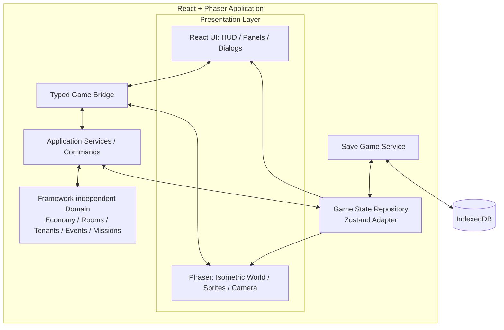

# Boarding House Tycoon — Technical Architecture & Implementation Plan

**Document ID:** BHT-TECH-001  
**Version:** 1.0  
**Status:** Proposed baseline — ready for technical spike  
**Owner:** Engineering  
**Related document:** `Boarding_House_Tycoon_GDD_v2`  
**Target:** One responsive web application for desktop, Android Chrome, and iOS Safari. A store wrapper is deferred (ADR 0003).

---

## 1. Purpose

This document defines how the MVP described in the Game Design Document (GDD) will be implemented. It records the technology choices, application boundaries, runtime flow, persistence rules, testing strategy, and implementation sequence so that development does not depend on undocumented assumptions.

The GDD remains the source of truth for **gameplay rules and balance values**. This document is the source of truth for **technical structure and implementation rules**.

### 1.1 Design and engineering goals

- Build a 2D isometric, portrait-first, responsive web game using the JavaScript/TypeScript ecosystem.
- Reuse React for application UI while using a dedicated 2D framework for the game world.
- Keep gameplay rules independent of React and Phaser.
- Make the browser build the fastest development and test target.
- Run the same responsive web build in desktop browsers, Android Chrome, and iOS Safari. A store wrapper is an optional later step (ADR 0003).
- Keep the MVP local-first; do not require a backend to play the game.
- Make economy, event, mission, and progression values data-driven and easy to balance.

### 1.2 Non-goals for the MVP

- 3D rendering or a physics-heavy simulation.
- Tenant pathfinding, daily schedules, needs simulation, or relationship simulation.
- Multiplayer, social systems, leaderboards, or competitive economies.
- Cloud accounts, cloud save, remote configuration, or server-authoritative economy.
- Live operations, ad mediation, in-app purchases, or monetization.
- A full building editor or user-generated layouts.

---

## 2. Technology Decisions

### 2.1 Approved MVP stack

| Layer | Decision | Responsibility |
|---|---|---|
| Language | TypeScript | Application, domain, game integration, and tooling |
| UI | React | HUD, menus, room panels, tenant panels, mission panel, event dialogs |
| Build tool | Vite | Local development server and production web bundle |
| 2D game framework | Phaser 4.x | Isometric world, sprites, input, camera, animation, scene lifecycle |
| Client state adapter | Zustand | Expose serializable game/UI state to React and the Phaser bridge |
| Local persistence | IndexedDB | Save slot and game progress persistence |
| Store wrapper (deferred) | None in MVP; Capacitor 8.x if a store listing is required later | Optional packaging for store distribution only; see ADR 0003 |
| Unit tests | Vitest | Domain and application logic tests |
| Browser E2E tests | Playwright | Test user flows in a real browser |
| Package manager | pnpm | Dependency installation and lockfile management |

Use the latest stable compatible patch versions when the repository is scaffolded. Pin exact dependency versions in `package.json` and commit `pnpm-lock.yaml`. Do not use floating CDN script tags for production dependencies.

**Runtime baseline:** Node.js 22.12 or newer is a safe minimum for the selected Vite toolchain. Re-check the Node requirement if a store wrapper is added later. Use one supported Node LTS release consistently in local development and CI. Record it in `.nvmrc` or `.node-version`.

### 2.2 Why React + Phaser

React and Phaser have separate responsibilities:

- React owns conventional application UI and DOM layout.
- Phaser owns the interactive 2D game world and its render/update lifecycle.
- TypeScript domain modules own game rules and state transitions.
- A store wrapper (Capacitor, if ever added) is deferred; it would only provide packaging and is not the game engine.

Phaser is selected because the game is a 2D, touch-driven tycoon with sprite-based rooms and characters. The MVP does not need a full 3D engine or complex physics. Phaser supports JavaScript/TypeScript and can be integrated into React-based applications.

### 2.3 Explicit alternatives not selected for MVP

| Alternative | Decision | Reason |
|---|---|---|
| React + CSS/SVG/Canvas only | Not selected | Would require the team to build too much rendering, camera, input, and animation infrastructure itself |
| Cocos Creator | Reconsider only if needed | A strong engine/editor workflow, but the chosen web-first React architecture is a better fit for the current team and scope |
| Unity | Not selected | Its broader 3D/editor/tooling capabilities are not required by this MVP; it would introduce a different primary language and workflow |
| PixiJS | Not selected initially | A rendering-focused alternative, but Phaser provides more of the 2D game framework features needed by this MVP |

These are scope decisions, not claims that the alternatives are technically incapable.

---

## 3. Runtime Architecture

### 3.1 High-level component layout



### 3.2 Ownership boundaries

| Component | Owns | Must not own |
|---|---|---|
| React | UI layout, menus, forms, HUD, dialogs, accessibility | Phaser sprites, camera, frame loop, economy calculations |
| Phaser | World rendering, hit areas, camera, visual animation, scene lifecycle | Canonical Cash balance, mission completion rules, save format |
| Domain | Rules, validation, calculations, state transitions | DOM, React hooks, Phaser objects, browser APIs |
| Application services | Command orchestration, validation flow, persistence coordination | Rendering details |
| State repository | Current serializable game snapshot and subscriptions | Phaser display objects or React component instances |
| Save service | Serialization, schema versioning, load/save transactions | Gameplay policy beyond applying a validated save/migration |
| Browser platform adapter | Page visibility/lifecycle events, viewport and safe-area sizing, storage persistence requests | Core game rules |

**Hard rule:** Domain code must not import `react`, `phaser`, `zustand`, or `@capacitor/*` (no store wrapper in MVP; see ADR 0003). Framework-specific integrations belong in adapters outside the domain layer.

### 3.3 React and Phaser composition

The application renders one Phaser canvas inside a React-owned host element.

- React must create and destroy the Phaser game instance through a lifecycle-safe wrapper (for example, an effect with cleanup).
- A React re-render must not recreate the Phaser game instance.
- Phaser must not render the standard HUD, menus, forms, or long text dialogs.
- React must not render every room/character as a DOM element when that object belongs to the game world.
- Do not put per-frame position values into React state. Phaser owns frame-by-frame visual updates.
- Only meaningful game state changes should cross the bridge: room selected, tenant selected, event opened, upgrade completed, candidate accepted, and similar actions.

---

## 4. Project Structure

Recommended single-app structure:

```text
boarding-house-tycoon/
├── docs/
│   ├── gdd/
│   │   └── game-design-plan.md
│   └── plan/
│       └── technical-architecture.md
├── public/
│   └── assets/
│       ├── atlases/
│       ├── buildings/
│       ├── rooms/
│       ├── tenants/
│       ├── events/
│       ├── ui/
│       └── audio/
├── src/
│   ├── app/
│   │   ├── App.tsx
│   │   ├── layout/
│   │   ├── screens/
│   │   └── components/
│   ├── game/
│   │   ├── bootstrap/
│   │   ├── scenes/
│   │   ├── world/
│   │   ├── entities/
│   │   ├── input/
│   │   ├── camera/
│   │   └── bridge/
│   ├── domain/
│   │   ├── economy/
│   │   ├── building/
│   │   ├── room/
│   │   ├── tenant/
│   │   ├── event/
│   │   ├── mission/
│   │   ├── progression/
│   │   ├── time/
│   │   └── shared/
│   ├── application/
│   │   ├── commands/
│   │   ├── queries/
│   │   └── services/
│   ├── state/
│   │   ├── game-state.ts
│   │   ├── game-store.ts
│   │   └── selectors.ts
│   ├── persistence/
│   │   ├── save-game-service.ts
│   │   ├── indexeddb-adapter.ts
│   │   └── migrations/
│   ├── platform/
│   │   ├── lifecycle.ts
│   │   └── viewport.ts
│   ├── config/
│   │   ├── economy.config.ts
│   │   ├── tenant.config.ts
│   │   ├── event.config.ts
│   │   └── progression.config.ts
│   ├── locales/
│   │   └── vi.json
│   └── main.tsx
├── tests/
│   ├── unit/
│   ├── integration/
│   └── e2e/
├── vite.config.ts
├── tsconfig.json
├── package.json
└── pnpm-lock.yaml
```

The folder structure is a starting convention, not a requirement to create empty folders before they are needed. Keep modules small and create folders when the first real implementation arrives.

---

## 5. Domain Model and Game State

### 5.1 Canonical game state

The game must have one canonical, serializable `GameState`. React and Phaser are consumers of this state; they must not keep independent copies of gameplay truth.

Suggested top-level shape:

```ts
interface GameState {
  schemaVersion: number;
  player: {
    cashMinorUnits: number;
    lifetimeGrossIncomeMinorUnits: number;
  };
  building: {
    buildingId: string;
    roomCapacity: number;
    rooms: RoomState[];
  };
  tenants: TenantState[];
  candidates: TenantCandidate[];
  events: EventState;
  missions: MissionState;
  progression: ProgressionState;
  time: {
    lastCheckpointAt: number;
    incomeRemainderMinorUnits: number;   // net-income fraction carried between accruals
    grossRemainderMinorUnits: number;    // gross fraction carried, for lifetime gross
    onlineMs: number;                    // accumulated online time (cooldowns, event checks)
  };
}
```

Exact fields may be refined during implementation, but the following rules are mandatory:

- Save only plain serializable data: strings, numbers, booleans, arrays, and objects.
- Never save Phaser `Sprite`, `Scene`, `Camera`, DOM nodes, class instances with runtime references, or functions.
- Use stable IDs for rooms, tenants, events, candidates, and missions.
- Room occupancy is represented by a tenant ID or an explicit vacant status; do not infer occupancy from whether a visual sprite exists.
- Store a save schema version and support explicit migrations when the shape changes.

### 5.2 Currency precision

GDD balance tables display whole Cash values. Runtime income accrues continuously, so the implementation must avoid losing fractional income every minute.

Recommended implementation:

- Store currency internally in integer minor units (for example, 100 minor units = 1 displayed Cash).
- Convert GDD whole-Cash prices and rewards to minor units at the domain boundary.
- Format the HUD as whole Cash or two decimal places according to the final UI decision.
- Never use floating-point currency values for affordability comparisons.

### 5.3 Data-driven balance configuration

Keep tunable values out of rendering code and component files. Use typed configuration modules for:

- Room rent and upgrade requirements.
- Room construction costs and capacity unlocks.
- Tenant budget, preferred room level, and spawn weights.
- Event eligibility, cooldown, and outcome payloads.
- Mission objectives and rewards.
- Offline cap and time scale.

The GDD is the source of truth for the actual baseline values. Do not duplicate a second, independently maintained balance table in this document or in Phaser scene code.

---

## 6. Gameplay Application Services

Domain rules are implemented as deterministic functions or services. Each player action is sent as a command, validated, applied to the canonical state, and then reflected in React and Phaser.

### 6.1 Initial command set

| Command | Required validation | Result |
|---|---|---|
| `buildRoom(roomId)` | Capacity available; enough Cash; room does not already exist | Adds a vacant room and deducts cost |
| `upgradeRoom(roomId)` | Room exists; next level exists; enough Cash; tenant can afford the new rent or room is vacant | Upgrades room and deducts cost |
| `acceptCandidate(candidateId, roomId)` | Candidate exists; room is vacant; rent does not exceed hard budget | Assigns tenant and removes candidate |
| `rejectCandidate(candidateId)` | Candidate exists | Removes candidate without penalty |
| `resolveEvent(eventId, choiceId)` | Event is active; choice exists; player can afford required cost | Applies deterministic outcome and closes event |
| `advanceTime(now)` | Timestamp is valid and later than checkpoint | Calculates eligible rent and advances checkpoint |
| `claimMissionReward(missionId)` | Mission objective is complete and reward is unclaimed | Adds reward and advances mission progression |

Commands return a typed success/failure result. The UI must display a useful reason when a command is rejected; it must not optimistically show a purchase as successful before validation completes.

### 6.2 Economy service

The economy service is responsible for:

- Calculating gross rent from occupied rooms.
- Calculating automatic operating cost using the GDD rule.
- Calculating net rent per game day/hour.
- Calculating active and offline income.
- Validating affordability and applying purchases.
- Keeping fractional accrual without floating-point currency comparisons.

It must not depend on Phaser or React.

### 6.3 Tenant service

The tenant service owns:

- Candidate generation schedule.
- Archetype spawn weights.
- Hard budget eligibility.
- Preferred room level as a soft preference, unless the GDD explicitly defines it as a hard rule.
- Accept/reject flow.
- Tenant-to-room assignment.

A candidate is generated only when a suitable vacant room exists and the queue has capacity. Candidate generation pauses while the app is backgrounded. Candidate queue state is persisted.

### 6.4 Event service

The event service owns:

- Online-only eligibility checks.
- One-active-event rule.
- Global and per-event cooldowns.
- Rolling event-count cap.
- Event selection from currently eligible events.
- Deterministic choice outcomes.

Randomness must be injected behind an interface so tests can use a seeded or fixed random source. Do not hide additional random penalties inside an event choice.

### 6.5 Mission and progression services

- Mission progress is derived from domain events or state transitions, not from UI button clicks alone.
- A mission must not progress when the corresponding action failed validation.
- Unlock conditions are evaluated centrally.
- A locked feature must not be reachable through a hidden UI route or direct command.
- Mission and progression state must survive reloads.

---

## 7. Isometric World and Rendering Plan

### 7.1 Rendering approach

Use a 2D isometric scene built from sprites and layered artwork. The MVP does not require a true 3D world.

- Use authored sprite assets for the building shell, room interiors, furniture, tenants, props, and visual upgrade states.
- Use Phaser scenes to separate loading/bootstrap from the main gameplay world.
- Use camera pan/zoom only where it improves usability; the initial MVP may use a fixed camera if all six rooms fit comfortably on a portrait screen.
- Use sprite/container depth ordering based on the object's ground contact point or an explicit layer index.
- Use transparent PNG or WebP assets as appropriate; group related sprites into atlases where it reduces draw calls and simplifies asset loading.

### 7.2 Isometric coordinates

For a regular diamond tile grid, a conventional transform is:

```ts
screenX = (gridX - gridY) * (tileWidth / 2);
screenY = (gridX + gridY) * (tileHeight / 2);
```

The MVP may use authored fixed positions rather than a fully general-purpose tilemap. Do not build a level editor or arbitrary tile placement system unless the design later requires it.

### 7.3 Depth and hit testing

- Set depth using the object's ground anchor, not its top-left image coordinate.
- Provide clear hit areas for each room; avoid making furniture sprites independently interactive unless required.
- Ensure room selection is reliable on touch screens and does not depend on hover.
- Keep decorative animation lightweight: ambient motion, small character reactions, and upgrade transition effects.
- No tenant pathfinding, collision simulation, or physics system is required for the MVP.

### 7.4 Visual state mapping

A room's rendered appearance is derived from its domain state:

- Vacant vs occupied.
- Level 1 vs Level 2 vs Level 3.
- Optional temporary event state, such as a broken facility indicator.

Phaser must not decide the room's level. It receives the new state and updates the sprite/animation accordingly.

---

## 8. React UI and Game Bridge

### 8.1 UI ownership

React owns:

- Cash and income HUD.
- Main mission card and progress display.
- Room detail panel.
- Candidate/tenant management panel.
- Event dialog and choice buttons.
- Settings, pause, save/load feedback, and onboarding overlays.

Phaser owns:

- Boarding-house environment.
- Room and tenant sprites.
- Visual selection state.
- Camera and world animation.

### 8.2 Typed bridge contract

Use an explicit typed bridge rather than importing React modules into Phaser or Phaser classes into React components.

Example event names:

```ts
type GameToUiEvent =
  | { type: 'ROOM_SELECTED'; roomId: string }
  | { type: 'TENANT_SELECTED'; tenantId: string }
  | { type: 'WORLD_READY' };

type UiToGameCommand =
  | { type: 'SELECT_ROOM'; roomId: string }
  | { type: 'CLEAR_SELECTION' }
  | { type: 'PLAY_UPGRADE_EFFECT'; roomId: string; newLevel: number };
```

Use typed functions or a small event-bus abstraction. Avoid untyped global events and avoid passing Phaser object references across the bridge.

---

## 9. Time, Active Income, and Offline Progression

### 9.1 Time model from the GDD

- One in-game day equals one real-time hour.
- Rent accrues continuously while the game is active.
- Offline income is capped at eight real-time hours.
- Events and candidate generation do not progress while the app is backgrounded.
- The GDD's net-income and operating-cost rules remain authoritative.

### 9.2 Income calculation

Let:

- `netRentPerGameDay` be the sum of net rent for occupied rooms.
- `elapsedSeconds` be the eligible elapsed real time.
- One game day be 3,600 real seconds.

Then:

```text
income = netRentPerGameDay * (elapsedSeconds / 3,600)           # no modifier active
offlineElapsed = min(max(now - lastCheckpointAt, 0), 8 hours)
offlineIncome = integral over [lastCheckpointAt, lastCheckpointAt + offlineElapsed]
                of netRentAt(t) / 3,600 dt
```

`netRentAt(t)` is the net rent per game day at time `t`. It equals `netRentPerGameDay` multiplied by `(1 - reduction(t))`, where `reduction(t)` is the sum of the active building-wide income reductions at `t`, capped at 25%. Each temporary modifier has an absolute expiry timestamp. To compute `offlineIncome`, split the offline interval at every modifier expiry inside it, then sum the constant-rate segments. Modifiers elapse while offline; they are not paused.

Convert the result to integer minor currency units and preserve any fractional remainder. The implementation must not round down every short tick independently, as that would silently destroy income over time.

### 9.3 Checkpoint and resume rules

1. On a normal active session, advance income using the elapsed time since the previous simulation checkpoint.
2. Save a checkpoint periodically (recommended every 60 seconds) and immediately after material state changes.
3. On app background, attempt an immediate save and record the checkpoint time.
4. On resume/reload, calculate elapsed time from the persisted checkpoint, clamp negative elapsed time to zero, and cap eligible offline time at eight hours.
5. Apply offline income and update the checkpoint in the same persistence transaction.
6. Do not run the same offline interval a second time.
7. If the device clock moved backwards, grant zero offline income for the negative interval and reset the checkpoint to the current time after successful recovery.

For the local-only MVP, wall-clock manipulation cannot be fully prevented. The eight-hour cap limits the effect. Server-authoritative time is deferred until cloud accounts, purchases, or competitive features require it.

### 9.4 App lifecycle

Use browser lifecycle events (`visibilitychange` and `pagehide`) through the platform adapter. Lifecycle callbacks are best-effort; periodic checkpoints remain necessary because mobile browsers, especially iOS Safari, can discard a backgrounded tab without a final callback.

---

## 10. Persistence and Save Data

### 10.1 MVP persistence decision

Use IndexedDB for the local save slot. Keep the persistence interface replaceable so a cloud-save adapter can be added later.

Local save is sufficient because the MVP is single-player and does not require account login or cross-device sync. A .NET backend is not required to prove the core gameplay loop.

### 10.2 Save requirements

- One local primary save slot for MVP.
- Save data is versioned with `schemaVersion`.
- All IDs are stable and unique.
- Save after material actions such as build, upgrade, accept/reject candidate, resolve event, mission reward, and milestone unlock.
- Autosave at least every 60 seconds during active play.
- Save on background/visibility change where possible.
- Load and migrate before the main game becomes interactive.
- If the save is invalid, preserve the corrupt payload for diagnostics when practical and present a recoverable error; do not silently replace it with a fresh game.

### 10.3 Migration policy

- Every breaking save-shape change requires a migration function from the previous schema version.
- Migrations must be deterministic and unit tested with representative old save fixtures.
- Do not rely on renaming a TypeScript interface as a migration.
- Keep a small number of previous schema migrations; document when old save versions are no longer supported.
- Migrations are sequential (`vN -> vN+1`, each stamping `schemaVersion = N+1`), so any old save reaches the current shape by running the chain. A save with a higher `schemaVersion` is rejected, never migrated backwards.

Schema history:

| Version | Change | Migration |
|---|---|---|
| 1 | Initial local save | — |
| 2 | Event system and online clock (`events`, `time.onlineMs`) | stamps `schemaVersion: 2`, adds event and online-clock defaults |
| 3 | Gross remainder carried between accruals (`time.grossRemainderMinorUnits`) | stamps `schemaVersion: 3`, sets the remainder to `0` |

### 10.4 Time integration rules

- Foreground ticks run once per second. A gap of 30 seconds or more, or the first visible tick after the page was hidden, is treated as an offline resume: the elapsed time is integrated with the offline cap (8 hours) and the online timers do not advance.
- Online timers (`onlineMs`, cooldowns, the 5-minute candidate and event check) advance only on the online path.
- Income is credited through one shared helper. Net and gross fractions are carried in state, so no income is lost to rounding.
- Net rent uses the reduction in effect at each segment boundary, capped at 25%. Modifiers that expire mid-interval split the interval at their expiry.
- Saves are written in the order they were requested, so a later save can never be overwritten by an earlier one.

### 10.4 Future backend seam

If future requirements include account login, cross-device cloud save, remote balance configuration, analytics, or purchase validation, add an API adapter behind the save/account interfaces. An ASP.NET Core backend is a reasonable future option, but it is not part of the MVP critical path.

---

## 11. Asset Pipeline

### 11.1 Asset categories

- Building/environment: base building, facade states, floors, roof, walkway, shared facilities.
- Rooms: Level 1/2/3 interior variants and key furniture silhouettes.
- Tenants: three MVP archetypes, portraits, small in-world sprites, reaction frames.
- Events: event illustrations or character portraits for the five MVP events.
- UI: icons, currency symbol, buttons, badges, panels, mission markers.
- Audio: small set of UI and feedback sounds; no requirement for a large soundtrack in the first vertical slice.

### 11.2 Asset rules

- Establish one approved art direction before production asset creation: 2D isometric / 2.5D cartoon, bright and friendly, Vietnamese boarding-house setting.
- Keep concept references separate from production assets.
- Production assets must have consistent camera angle, perspective, light direction, outline/shadow treatment, and scale.
- Use predictable names and source files; keep exported runtime assets in `public/assets`.
- Use atlases for compatible sprite groups after the art pipeline is understood.
- Provide at least one visible visual change for each room level.

---

## 12. Testing Strategy

### 12.1 Unit tests — Vitest

Prioritize deterministic domain logic:

- Rent and net-income calculation.
- Currency precision and affordability.
- Room build and upgrade validation.
- Tenant budget and room eligibility.
- Candidate spawn weights and queue capacity.
- Event cooldown, active-event limit, rolling event cap, and outcome application.
- Mission progress and milestone unlocks.
- Offline income cap, negative clock delta, repeated resume, and fractional remainder.
- Save serialization and schema migrations.

Inject time and random number providers into services. Tests must not depend on real timers or uncontrolled randomness.

### 12.2 Integration tests

- Application command updates the canonical state.
- State changes reach React selectors and Phaser bridge subscribers.
- Phaser room selection opens the correct React room panel.
- React upgrade action updates the room's domain level and Phaser visual state.
- Save/reload restores all relevant game state.

### 12.3 End-to-end tests — Playwright

Core happy path:

1. Start a new game.
2. Accept a candidate into a vacant room.
3. Upgrade an eligible room.
4. Build the next room when capacity and Cash allow it.
5. Trigger and resolve a test event.
6. Complete a mission and claim its reward.
7. Reload the browser and verify the state remains correct.

Add specific regression tests for offline income being applied once and never exceeding the eight-hour cap.

### 12.4 Real-device checks

Before release, test the web build in the default browser on at least:

- One mid-range Android phone (Chrome).
- One lower-end Android phone representative of the target audience (Chrome).
- One iPhone (Safari). iOS is in MVP scope through the browser.

Check touch and mouse input, screen safe areas, orientation changes, tab background and return, audio behavior, loading time, memory use, and frame rate. Browser emulation is not a replacement for real-device testing.

---

## 13. Performance and Responsive UX Requirements

- Portrait phone (9:16) is the primary layout. Landscape phone and desktop widths scale the same scene and panels; gameplay does not depend on orientation or screen size.
- Touch and mouse input both work; no required hover states.
- Interactive controls should have comfortable touch targets (aim for at least 44 CSS pixels where practical).
- Respect device safe areas and notches (CSS `env(safe-area-inset-*)`).
- Avoid unnecessary React renders from Phaser's frame loop.
- Avoid creating/destroying the Phaser game on ordinary React re-renders.
- Load only the assets required for the current MVP scene.
- Prefer sprite atlases and compressed textures where appropriate.
- Target smooth 60 FPS on capable mid-range devices; keep the game usable at 30 FPS on lower-end supported devices. Confirm the actual target-device floor during the technical spike.
- Profile real devices before adding particles, large animated crowds, or expensive full-screen effects.

---

## 14. Security, Integrity, and Backend Boundary

The MVP is a local single-player game. Local save files and client-side currency can be modified by a technically capable user. This is acceptable for the MVP because there are no leaderboards, competitive rankings, account balances, or real-money transactions.

Do not describe local state as cheat-proof. If any of the following are introduced, revisit the trust model:

- In-app purchases or paid currency.
- Competitive leaderboards or rewards.
- Cross-device account progression.
- Server-issued rewards or time-limited offers.
- Any feature where save tampering creates business or fairness risk.

At that point, move authoritative entitlements, purchases, and sensitive reward validation to a backend. A .NET API can be added without moving the client-side renderer or rewriting the domain model if the interfaces in this plan are respected.

---

## 15. Implementation Plan

Build in small vertical increments. Do not implement every subsystem before validating that the game world and input feel right on a phone.

### Phase 0 — Technical spike

**Goal:** Prove the selected stack before committing to full implementation.

Tasks:
- Create a Vite + React + TypeScript project.
- Integrate Phaser 4.x as a single canvas hosted by React.
- Render one isometric building/room sprite and one selectable room hit area.
- Verify touch and mouse input, and portrait and landscape scaling.
- Mount/unmount Phaser safely without duplicate game instances.
- Serve the responsive web build and open it in Chrome on an Android device and Safari on an iPhone.

Exit criteria:
- Room can be selected reliably with touch.
- React can display a room detail panel based on the Phaser selection.
- No duplicate Phaser instances after route changes or hot reload.
- The same build renders correctly in desktop browsers and in mobile browsers (Android Chrome, iOS Safari).

### Phase 1 — Domain foundation

Tasks:
- Define typed GameState and IDs.
- Implement economy configuration and currency precision.
- Implement room build/upgrade commands.
- Implement tenant candidate eligibility and accept/reject.
- Add unit tests for all rules.
- Add IndexedDB save/load with schema versioning.

Exit criteria:
- Domain tests pass.
- Save/load round-trip is correct.
- React and Phaser consume the same canonical state.

### Phase 2 — Core vertical slice (2 to 4 rooms)

Tasks:
- Build the initial isometric scene.
- Render two starting rooms and the first expansion to four rooms.
- Add Level 1 and Level 2 visual states.
- Add Cash HUD, room detail panel, candidate panel, and main mission card.
- Implement automatic rent and operating costs.
- Implement save/resume and eight-hour offline calculation.

Exit criteria:
- The player can accept a tenant, earn income, build/upgrade rooms, close/reopen the app, and continue without state loss or duplicate income.

Open items for Phase 2 (not yet decided or produced):
- **Vietnamese copy for HUD, panels, mission card, onboarding** (GDD 9.1, 9.2). Owner: product owner, per GDD 9.1. Key skeleton created at `src/locales/vi.json` with empty values; the copy itself is not written. UI code references keys from this file from the first build. Values may use `{name}` placeholders for amounts and levels.
- **Tenant display names** (Vietnamese, GDD 9.1). No name list exists. Owner: product owner. Decide whether names are a fixed list or generated per tenant.
- **Room layouts for 2 and 4 rooms** (GDD 10, Visual Direction checklist). Art lead designs; product owner approves before asset production. Art lead is not yet assigned.
- **Asset manifest** (open-questions E4). Not created. Create in Phase 2 with stable keys, anchors, and scale per asset (Visual Direction section 13).
- **Placeholder-art policy (decided).** Use placeholder shapes/colors with stable asset keys until production art is approved. Recorded in GDD section 10. Placeholder assets must be labeled and do not pass Visual Direction section 13.
- **Phase 0 carry-over:** minimum browser versions and real-device tests on Android Chrome and iOS Safari (GDD 9, ADR 0003).

### Phase 3 — MVP management systems

Tasks:
- Add the third room level and six-room capacity milestone.
- Add all three tenant archetypes.
- Add candidate queue and spawn rules.
- Add the five MVP events and deterministic choices.
- Add the main mission sequence and unlocks.
- Complete save migrations and regression tests.

Exit criteria:
- The complete MVP gameplay loop is playable from a fresh save through the six-room progression target.

Open items for Phase 3 (not yet decided or produced):
- **Pacing simulation (gate).** Required before Phase 3 starts (GDD 12). Numeric playtest targets (open-questions F1) follow from it. Owner not assigned.
- **Copy for the 5 MVP events** (title, description, and two choice labels showing cost and consequence; GDD 6.4). Owner: product owner.
- **Copy for the 7 missions** (player-facing text; objectives in GDD 7.1), and the **congratulation screen and run summary** after MVP completion (GDD 7.2, C5 default).
- **Level 3 room visuals** and the **six-room layout** (GDD 4.2, 10; open-questions E2). Art lead designs; product owner approves.
- **Tenant expressions:** 3 per archetype (idle, happy, annoyed; GDD 10), 9 variants total. Assets not produced; placeholders are acceptable.
- **Event illustrations.** No spec exists. Placeholder icon and text are acceptable for the first pass (Visual Direction section 8). Decide whether event art is required before Phase 4.
- **Sound effects.** Roughly 8 SFX plus a mute toggle (GDD 9.3, 9.4). No audio assets exist. Decide whether SFX land in Phase 3 or Phase 4.
- **Save migration fixtures** for every schema version introduced in Phase 2 and Phase 3 (Phase 1 save/load rules).

### Phase 4 — Mobile hardening

Tasks:
- Test on real Android and iOS devices in their default browsers, including iOS storage-eviction handling (ADR 0002, ADR 0003).
- Tune touch targets, safe areas, loading, memory, and frame rate.
- Verify lifecycle checkpoints and app termination recovery.
- Add production error logging and crash diagnostics appropriate to the release target.

Exit criteria:
- No known blocker in save integrity, touch input, or supported-device performance.

---

## 16. Definition of Done

A feature is done only when:

- Its gameplay rules are implemented in the domain layer, not hidden inside UI or Phaser code.
- Invalid actions are rejected with a typed reason.
- Its state is serializable and persisted when appropriate.
- Unit tests cover normal and edge cases.
- React and Phaser display the same state.
- It works with touch and mouse input at the portrait phone and desktop layouts.
- It does not introduce a duplicate timer, event, or offline-income path.
- Any balance value is sourced from the typed config and reconciled with the GDD.

---

## 17. Technical Risks and Mitigations

| Risk | Impact | Mitigation |
|---|---|---|
| Phaser instance recreated by React lifecycle | Duplicate scenes, listeners, and memory leaks | Single lifecycle wrapper, explicit destroy/cleanup, integration test |
| React and Phaser keep separate gameplay state | UI/world become inconsistent | One canonical serializable GameState and typed bridge |
| Offline income applied more than once | Economy exploit and save corruption | Atomic checkpoint + reward persistence and regression tests |
| Device clock changed | Incorrect offline payout | Clamp negative deltas, eight-hour cap; server time only if future trust requirements demand it |
| Isometric depth/hit areas feel inaccurate | Mis-selection and poor mobile UX | Ground-anchor depth rules and real-device touch testing |
| Too many assets loaded up front | Slow startup and memory pressure | Scene-based loading, atlases, asset budget, device profiling |
| GDD balance values drift from code | Incorrect progression | One typed config source; balance review checklist |
| Mobile browser performance and storage differ by browser (iOS Safari can evict unused storage) | Mobile release surprises and save loss | Real-device browser profiling in Phase 0 and Phase 4; `navigator.storage.persist()`, Settings warning, Home Screen recommendation (ADR 0002, ADR 0003) |

---

## 18. Repository Documentation and Decision Records

Recommended documentation layout:

```text
docs/
├── gdd/
│   └── game-design-plan.md              # Gameplay rules and balance source of truth
├── planning/
│   └── technical-architecture.md        # This document: stack and implementation plan
├── decisions/
│   ├── 0001-react-phaser-capacitor.md   # Why this stack was selected (platform parts superseded by 0003)
│   ├── 0002-local-first-save.md         # Why MVP does not require a backend
│   └── 0003-web-first-responsive-delivery.md  # Why the MVP ships as one responsive web build
└── art/
    └── visual-direction.md              # Production art rules and asset checklist
```

The `decisions/` records are recommended, not mandatory before the technical spike. Create them when the decision is implemented and likely to be revisited.

### 18.1 Change-control rules

- Gameplay changes belong in the GDD first, then in implementation.
- Architecture changes belong in this document or a decision record.
- Balance values must be changed in one typed config source and reflected in the GDD.
- Do not add a backend, a second game engine, or a new state-management library without recording the reason and the migration impact.
- Revisit the selected stack only if the technical spike reveals a concrete blocker (for example, unacceptable low-end mobile performance or an art/editor workflow that the team cannot support).

---

## 19. Official Technical References

The following official documentation was checked when preparing this plan. Confirm compatibility again when scaffolding the repository and pinning package versions.

- [Phaser documentation](https://docs.phaser.io/) — Phaser 4.x framework, scenes, input, cameras, game objects, and API references.
- [Phaser 4 documentation overview](https://www.phaser.io/oss/docs/) — versioned documentation including Phaser 4.1.0.
- [Phaser Scenes](https://docs.phaser.io/phaser/concepts/scenes) — scene lifecycle and separation of game areas.
- [Phaser Input](https://docs.phaser.io/phaser/concepts/input) — unified pointer, touch, and keyboard input.
- [React documentation](https://react.dev/learn) — component-based UI and state management.
- [Vite guide](https://vite.dev/guide/) — React + TypeScript templates, dev server, and build tooling.
- [Vite TypeScript features](https://vite.dev/guide/features) — TypeScript transpilation and the separate type-checking requirement.
- [Capacitor documentation](https://capacitorjs.com/docs) — deferred optional store wrapper (ADR 0003); reference only, not used in the MVP.
- [Playwright documentation](https://playwright.dev/docs/intro) — browser end-to-end testing.

---

## 20. Final Technical Decision

**Approved baseline for MVP:**

> React + TypeScript + Vite + Phaser 4.x + Zustand adapter + IndexedDB, delivered as one responsive web build. Store wrapper (Capacitor 8.x) is deferred (ADR 0003).

Build and validate the responsive web app on desktop and mobile browsers. Verify real-device browser behavior in the technical spike, and defer production mobile hardening until the 2-to-4-room vertical slice is playable. Capacitor is not part of the MVP.

Keep the domain model framework-independent. Do not introduce an ASP.NET Core backend for MVP; preserve an adapter seam so it can be added later for cloud save, accounts, analytics, or server-authoritative features.
